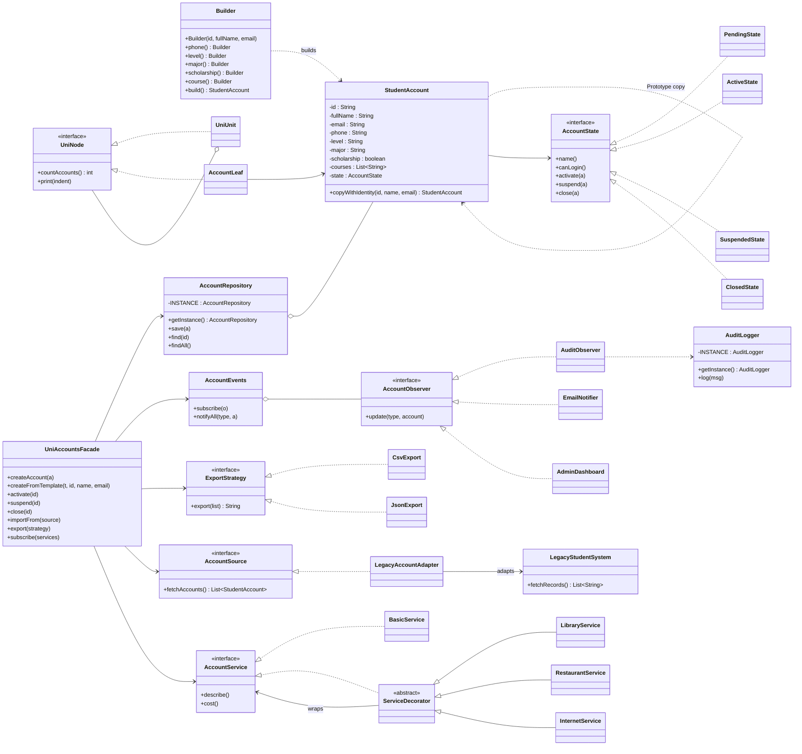
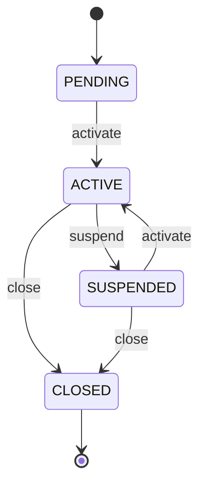

# UniAccounts — نظام إدارة حسابات الطلبة

**إعداد الطالبتين:** مريم بيه — ملاك احمادي

**المادة:** نماذج التصميم (Design Patterns) بلغة Java — العمل التطبيقي (TP)

---

## 1. طريقة التشغيل

المتطلبات: JDK 11 أو أحدث.

```bash
# من جذر المشروع
mkdir out
javac -d out src/uniaccounts/*.java
java -cp out uniaccounts.Main
```


---

## 2. هيكل المشروع (ملف لكل نمط)

```
src/uniaccounts/
├── Main.java                 تشغيل تجريبي
├── StudentAccount.java       Builder + Prototype (+ EventType)
├── Singletons.java           Singleton: AccountRepository, AuditLogger
├── State.java                State: AccountState + 4 حالات
├── Observer.java             Observer: AccountEvents + 3 مراقبين
├── Composite.java            Composite: UniNode, UniUnit, AccountLeaf
├── Strategy.java             Strategy: ExportStrategy, CsvExport, JsonExport
├── Adapter.java              Adapter: AccountSource, LegacyAccountAdapter
├── Decorator.java            Decorator: AccountService + 3 خدمات
├── Facade.java               Facade: UniAccountsFacade
└── LegacyStudentSystem.java  الصنف المقدَّم (لا يُعدَّل)
```

## 3. مخطط الأصناف (UML)



### مخطط حالات الحساب (State)



---

## 4. جدول ربط الأنماط بالأصناف

| العمل | النمط | الصنف / الأصناف | المشكلة المحلولة |
|---|---|---|---|
| 1 | Builder | `StudentAccount.Builder` | 8 حقول بعضها اختياري، تفادي منشئ طويل |
| 1 | Singleton | `AccountRepository`, `AuditLogger` | مستودع واحد وسجل تدقيق واحد |
| 1 | Prototype | `StudentAccount.copyWithIdentity()` | نسخ قالب الدفعة وتغيير الهوية فقط |
| 2 | Composite | `UniNode`, `UniUnit`, `AccountLeaf` | شجرة جامعة/كلية/قسم/فوج وعدّ الحسابات |
| 2 | State | `AccountState` + 4 حالات | سلوك الحساب حسب حالته |
| 2 | Observer | `AccountEvents`, `AuditObserver`, `EmailNotifier`, `AdminDashboard` | إعلام عدة أطراف بكل حدث |
| 2 | Strategy | `ExportStrategy`, `CsvExport`, `JsonExport` | تصدير بصيغ مختلفة |
| 2 | Adapter | `LegacyAccountAdapter` | ربط النظام القديم دون تعديله |
| 2 | Decorator | `ServiceDecorator` + 3 خدمات | توليفات خدمات مختلفة |
| 2 | Facade | `UniAccountsFacade` | واجهة بسيطة تخفي التعقيد |

---

## 5. ملاحظات (تعديلات على العمل الأول + بيانات النظام القديم)

- **تعديل على العمل الأول:** أُضيف حقل `state` إلى `StudentAccount` (مع `getState/setState`) لأن نمط State يحتاج حالة محفوظة في الحساب. لم يُغيَّر شيء آخر في Builder/Singleton/Prototype.
- **`LegacyStudentSystem`:** لم يُعدَّل محتواه؛ أُضيف سطر `package` فقط وصُحّحت الأقواس المكسورة في ملف PDF حتى يُترجم. تعليق الصنف يذكر ترتيب `ID;LASTNAME;FIRSTNAME;EMAIL;LEVEL` بينما نص المشكلة يذكر ترتيبًا آخر؛ اعتُمد ترتيب البيانات الفعلي.
- **بيانات قذرة في النظام القديم:** البريد `y. Rida@old.univ.dz` فيه فراغ فيُنظَّف في الـAdapter، والمعرّف `19990008` مكرر فيُرفض السجل الثاني (يُتخطى ويُطبع تنبيه) والاستيراد يتابع، فيُستورد 9 من 10.
- **Prototype:** يُنسخ كل شيء ما عدا الهوية (`id`, `fullName`, `email`) ويُصفَّر `phone` لأنه معلومة شخصية، وتُنسخ قائمة المقررات نسخًا عميقًا.
